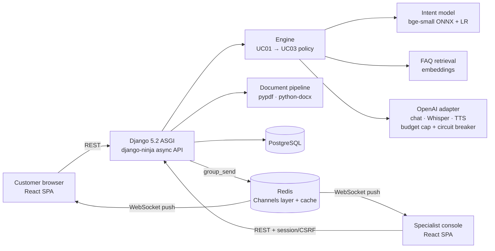

# AUBOT: AI customer-service assistant for Australian SMEs

Working prototype for **ITA602 Group 1** (Assessments 1–3). AUBOT answers routine customer enquiries, accepts and routes documents, and hands anything it can't answer confidently to a human, with the full conversation attached. **AUBOT Buddy** adds voice in and out.

| Use case | What the prototype does |
|---|---|
| **UC01 Handle Customer Enquiry** | Intent detection (10 intents) → templated answer. Below 60 % confidence, an LLM may answer **only from the business's FAQ**; otherwise → UC03. |
| **UC02 Document Submission** | PDF/DOCX ≤ 5 MB: validated (size, type, file signature, corruption, zip-bomb guard), text extracted, routed to a team, acknowledged with a case reference. |
| **UC03 Escalate to Human** | Triggered by low confidence, an unanswerable question, an unavailable AI provider, or the customer asking. The specialist gets the case reference, reason, customer details and full transcript, and replies live. |
| **AUBOT Buddy** | Mic → Whisper → the same UC01/UC03 engine → OpenAI TTS. Explicit consent first; audio never stored. Sentiment (VADER) logged and used only to soften tone. |

## Screens

**Customer** (`/`): chat with AI-disclosure banner, quick suggestions, document upload, voice (consent modal), always-visible *Talk to a human*, contact capture after hand-off, and live specialist replies.

**Staff console** (`/staff`):
- **Overview:** chats, automation rate, waiting cases, documents, AI spend vs. cap, chats per day, top intents, sentiment.
- **Cases:** live queue; transcript with intent, confidence and sentiment per turn; accept, reply and resolve.
- **Documents:** routed uploads, extracted text, status, download.
- **Evaluation:** run TC01–TC04 and keep the results as evidence.
- **Settings** (owner only): Buddy name, greeting, tone and voice, plus business details, with no retraining. FAQ entries are edited in Django admin.

## Architecture



* **Stateless app servers.** All state is in PostgreSQL and Redis, so you can add uvicorn workers or containers behind a load balancer and they share rate limits, budget state and WebSocket fan-out.
* **Async end to end.** Slow OpenAI calls never hold a worker. CPU work (classification, PDF parsing) runs off the event loop.
* **Vendor adapters.** All OpenAI code is in `backend/core/llm.py`; intent backends sit behind one interface (`local`, `tfidf`, `dialogflow`).

## Quick start (macOS, no Docker)

```bash
brew install python@3.12 node postgresql@16 redis
brew services start postgresql@16 && brew services start redis
createdb aubot
cp .env.example .env            # add OPENAI_API_KEY and DATABASE_URL=postgres://$USER@localhost:5432/aubot

cd backend
python3.12 -m venv .venv && .venv/bin/pip install -r requirements-dev.txt
.venv/bin/python manage.py migrate
.venv/bin/python manage.py seed_demo        # prints the owner + specialist passwords once
cd ../frontend && npm install && npm run build
cd ../backend && .venv/bin/uvicorn config.asgi:application --port 8000 --workers 2
```

Open http://localhost:8000 (customer) and http://localhost:8000/staff (console). API docs: http://localhost:8000/api/docs.
For frontend development, also run `npm run dev` in `frontend/` and use http://localhost:5173 (it proxies the API and WebSockets).

**Docker:** `docker compose up --build`, then `docker compose exec web python manage.py seed_demo`.

## Tests and benchmarks

```bash
cd backend && .venv/bin/python -m pytest -q                 # 22 tests incl. TC01–TC04 thresholds
.venv/bin/python manage.py run_evaluation                   # stores results (also in the console)
cd .. && backend/.venv/bin/python scripts/benchmark.py \
   --staff-user specialist --staff-password '…' [--voice]   # concurrency, TC02 over HTTP, live hand-off, TC05
```

### Results (local run on 26 Oct 2026, MacBook, 2 uvicorn workers)

| Test | Target (A2 Table 8) | Result |
|---|---|---|
| TC01 intent accuracy (100 held-out queries) | ≥ 85 % | **91 %** (88 % also above the 60 % confidence bar) |
| TC02 documents (9 cases incl. 2 MB PDF, 1 MB DOCX, 8 MB, corrupt, renamed .exe) | 100 %, ack ≤ 10 s, error ≤ 5 s | **9/9**, slowest 164 ms over HTTP |
| TC03 escalation (20 vague/conflicting queries) | 100 % of low-confidence handled safely | **11/11 escalated**, transcripts 11/11 complete; see the limitation on detection below |
| TC04 sentiment (50 labelled utterances, VADER) | ≥ 80 % | **90 %** |
| TC05 voice latency (Whisper → answer → TTS) | ≤ 5 s | **Not yet measured**: the OpenAI account had no API credit |
| 10 concurrent chat requests | ≤ 3,000 ms | **p95 70 ms** from a cold start |
| Specialist reply → customer screen | — | **15 ms** via WebSocket |

## Decisions and deviations from Assessments 1 & 2

| # | Spec said | Built | Why |
|---|---|---|---|
| 1 | UC01: GPT-4 fallback for out-of-intent queries. UC03: escalate everything below 60 %. | Below 60 %, the LLM may answer **only from the FAQ** (strict JSON `answerable` flag); otherwise escalate. | The two rules contradict each other. A1 itself says "knowledge-based fallback". Grounding stops invented prices and policies. TC03 is scored as "escalated *or* FAQ-grounded"; escalation rate is still reported. *(Agreed with the team lead.)* |
| 2 | Dialogflow CX free tier | Local embedding classifier by default; Dialogflow ES adapter kept (`AUBOT_INTENT_BACKEND=dialogflow`) | CX has no "1,000 free interactions" tier, and setup needs GCP credentials. Local results are reproducible for TC01, cost nothing and take about 2 ms per query. Model chosen by 5-fold cross-validation on training phrases only (TF-IDF ≈ 70 % vs embeddings ≈ 92 %); the test set stayed held out. *(Agreed.)* |
| 3 | GPT-4 | `gpt-4.1-mini` (configurable via `OPENAI_MODEL`) | GPT-4 is a legacy model. A small current model is faster (helps the 5 s voice target) and far cheaper (helps the AUD 50 cap). *(Agreed: OpenAI.)* |
| 4 | PyPDF2 | `pypdf` | PyPDF2 is deprecated; `pypdf` is its maintained successor. |
| 5 | HF Transformers + VADER | VADER default; HF optional (`requirements-hf.txt`, `AUBOT_SENTIMENT_BACKEND=hf`) | PyTorch is ~2 GB, beyond free-tier RAM. VADER scored 90 % on TC04. |
| 6 | Conflicting thresholds (80 vs 85 % intent, 70 vs 80 % sentiment, 5 vs 10 queries per intent) | The stricter value each time (85 %, 80 %, 10×10) | Avoids claiming a pass on the weaker number. |
| 7 | "Row-level access controls" on PostgreSQL | Role-based access in Django (`Specialists`, `Owners` groups); customer chats protected by per-session random tokens (hashed at rest) | Achieves the APP 11 intent without database-level RLS complexity. |
| 8 | Prefix every AI response with a disclosure | Permanent disclosure banner, disclosure in the greeting (stored in every transcript), "AI" badge on every bot message | A text preface on every message would bury the answer, so the disclosure is shown on screen instead. |
| 9 | Synchronous Django | ASGI + django-ninja async + Channels/Redis | Needed for 10 concurrent LLM-backed requests ≤ 3 s, and for live hand-off. |
| 10 | — | Monthly **spend cap** and **circuit breaker** | Implements the A2 contingency rule: when credit runs out, AUBOT escalates instead of failing, and the mic hides itself. |
| 11 | — | **Retention purge** (`manage.py purge_expired`, default 90 days) | APP 11.2: destroy personal information that is no longer needed. Schedule daily. |
| 12 | Free-tier AWS/GCP | Docker image + compose; any container host | The app is cloud-agnostic; the deployment target is the team's choice. |

## Privacy and responsible AI (built in, not bolted on)

* **APP 1/5 transparency:** the AI-disclosure banner and greeting; the FAQ privacy answer names OpenAI (USA) as a cross-border recipient (**APP 8**).
* **APP 3 minimisation:** customers are anonymous; contact details are asked for only at hand-off and are optional.
* **APP 11 security:** hashed session tokens, staff-only document download (uploads are never publicly routable), CSRF on staff writes, rate limits, HTTPS-only cookies in production, retention purge.
* **Voice:** explicit, recorded consent; the server handles uploads in memory only; raw audio is never written to disk or the database; consent can be withdrawn at any time.
* **Human oversight (AI Ethics Principles: contestability, accountability):** "Talk to a human" is always one tap away; sentiment never blocks or triggers escalation.

## Known limitations (reported honestly)

* **TC03 detection:** the embedding model gave 9 of the 20 deliberately vague queries a confidence of 60 % or more. Most mapped to a plausible intent: for example, "my insurer rejected my claim because of your report" → *complaint*, which offers a human. TC03's pass rule (every *low-confidence* input handled safely) is met, but detection is 55 %. More out-of-scope training phrases, or a higher threshold, would raise it at some cost to automation.
* **TC05 and generative answers** are untested live until OpenAI credit is added. Tests mock OpenAI.
* **Docker image** has been written but not built on the development machine (Docker Desktop needs admin rights there). CI builds and tests the code itself.
* **Scanned PDFs** are accepted but not OCR'd (flagged for manual review), as A1 allows.
* **Demo business:** "Harbourside Home Services" and its FAQ are fictional placeholders for the SME owner to replace.

## Configuration

See `.env.example`. Key variables: `OPENAI_API_KEY`, `DATABASE_URL`, `REDIS_URL`, `DJANGO_SECRET_KEY`, `OPENAI_MODEL`, `AUBOT_MONTHLY_BUDGET_USD` (default 20), `AUBOT_CONFIDENCE_THRESHOLD` (0.6), `AUBOT_INTENT_BACKEND`, `AUBOT_SENTIMENT_BACKEND`, `AUBOT_RETENTION_DAYS`.

## Repository layout

```
backend/
  config/        settings, URLs, ASGI (HTTP + WebSocket routing)
  core/          business profile, FAQ, OpenAI adapter, auth/settings API, security helpers
  chat/          UC01/UC03 engine, intent models (nlu/), FAQ retrieval, customer + staff APIs, WebSockets
  documents/     UC02 validation, parsing, routing, API
  buddy/         voice endpoint, sentiment
  evaluation/    TC01–TC04 runner, synthetic TC02 fixtures, API
  data/          intents.yaml, faq.yaml, eval/ datasets (held out)
  tests/
frontend/src/    customer/ (chat), staff/ (console), api.ts, useSocket.ts, index.css (tokens, light/dark)
scripts/benchmark.py
```
